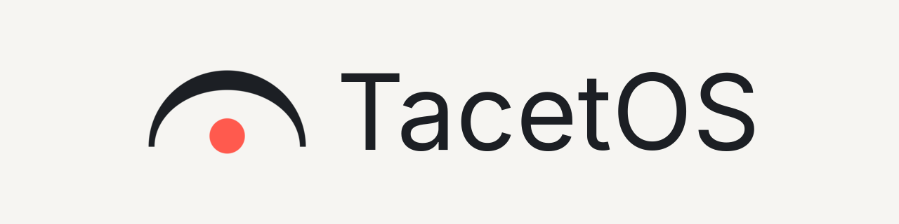

<h1 align="center">
  <picture>
    <source media="(prefers-color-scheme: dark)" srcset="docs/assets/logo/banner-dark.png">
    
  </picture>
</h1>

  
  
  
  
  

  
  
  
  

> **SOUND is at the end of silence.**

**TacetOS is a desktop app (Linux, Windows, macOS) and a custom firmware for the classic iPod.** Plug in your iPod, and the app sets everything up: it prepares the disk, installs the bootloader and the firmware, then lets you manage your music, settings and themes, all from one place.

> [!WARNING]
> **In development. Nothing works yet.** Do not use it on a real iPod. Until the public beta, development builds refuse to write to a real device. Follow the progress in the [roadmap](docs/ROADMAP.md).

## Why "TacetOS"?

*Tacet* is the word written on a musical score when an instrument stays silent. The music only starts when the silence ends.

## What it will do

- **Install, step by step.** The app detects your iPod and shows its state live: normal mode, disk mode, DFU, rebooting, copying... When a step has to be done by hand (like entering DFU mode on an iPod Classic), it shows a clear guide with the buttons to hold and a countdown, then carries on by itself.
- **Safe by design.** Blocking checks before any write, an automatic backup of the firmware partition, and a one-click way back to the original Apple software.
- **Your music library.** Cover art, tags, automatic sorting, drag-and-drop playlists, one-click sync, automatic conversion of formats the iPod cannot play.
- **Settings editor.** Every firmware setting in a clear form, with explanations, instead of editing a text file.
- **Theme editor.** Browse and install themes for your screen size, or make your own with a live preview.
- **Its own firmware.** With its own name, boot logo and default theme, updated from the app.
- **Translated.** Pick your language the first time you open the app, and change it anytime in Settings. English first, French next, then as many languages as possible.

## Progress

| Version | Focus | Done |
|---|---|---|
| Setup | Repository, app skeleton, CI | ✅ 4/4 |
| Foundations | Firmware base, model database, specs | ✅ 7/7 |
| **v0.1** | Device detection and live state | ✅ 7/7 |
| Test devices | Disk image test devices, privileged helper | ✅ 6/6 |
| **v0.2** | Install and reset wizard | ✅ 12/12 |
| **v0.3** | TacetOS firmware | ⏳ 6/12 |
| **v0.4** | Music library and sync | ⏳ 0/12 |
| **v0.5** | Settings, fonts, menus | ⏳ 0/8 |
| **v0.6** | Themes | ⏳ 0/11 |
| **v0.7** | Translations | ⏳ 0/3 |
| **v0.8** | Windows, macOS and Linux | ⏳ 0/6 |
| **v0.9** | Public beta: packages, one-command install, install guide | ⏳ 0/6 |
| **v1.0** | Fixes from the beta | ⏳ 0/1 |

### Now: TacetOS firmware

- [x] TacetOS name in the firmware, applied at build time
- [x] Lighter firmware: no test or developer plugins, games, emulators and visual demos kept
- [x] TacetOS boot logo, replaceable from the app by your own image or a black screen, quiet bootloader
- [x] Install progress on the iPod screen and in the app: logo and a progress bar
- [ ] CI builds for every model, plus simulators
- [ ] Update channel through GitHub Releases (public from the beta), settings and themes kept
- [ ] Weekly CI job to follow the base firmware
- [x] Language screen on the iPod at first start, English first, ready for more languages
- [ ] Real-device test: boot, logo, update from the app
- [ ] Selected fixes from newer firmware development, one tested change at a time
- [x] Technical folder name on the iPod Classic
- [ ] Health page: disk and battery state, with a warning when they wear out

Every task is listed in the [roadmap](docs/ROADMAP.md). News is posted on the [Discord server](https://discord.gg/XfXtZeUFYs).

## Supported models

The goal is the 6 classic iPod families, 14 models in all:

- **iPod (1G to 4G):**
  - 1G (FireWire only)
  - 2G (FireWire only)
  - 3G
  - 4G

- **iPod Color / Photo:**
  - Color / Photo

- **iPod Mini:**
  - Mini 1G
  - Mini 2G

- **iPod Nano:**
  - Nano 1G
  - Nano 2G

- **iPod Video:**
  - Video 5G
  - Video 5.5G

- **iPod Classic:**
  - Classic 6G
  - Classic 6.5G
  - Classic 7G

Only the iPod Classic is tested on real hardware during development. Other models will be marked *experimental* until beta testers confirm they work.

## Supported systems

- **Linux:**
  - Any distribution with udisks2

- **Windows:**
  - Windows 10 (version 1809 or later)
  - Windows 11
  - x64 and ARM64

- **macOS:**
  - macOS 12 Monterey or later
  - Intel and Apple Silicon

## Community

- Discord server: https://discord.gg/XfXtZeUFYs
- Contact me on Discord: vadmyro

Questions, ideas and bug reports go to the Discord server. TacetOS does not accept outside contributions: there are no issues or pull requests on GitHub. You are free to read the code and to fork it under the terms of the GPL.

## License

Copyright (C) 2026 vadmyro

TacetOS (app and firmware) is free software, released under the [GPL-3.0-or-later](LICENSE).

The TacetOS name and logo are not covered by the GPL: forks are welcome, but under another name and logo.

TacetOS is not affiliated with Apple. iPod is a trademark of Apple Inc. No Apple firmware is ever included or distributed.
